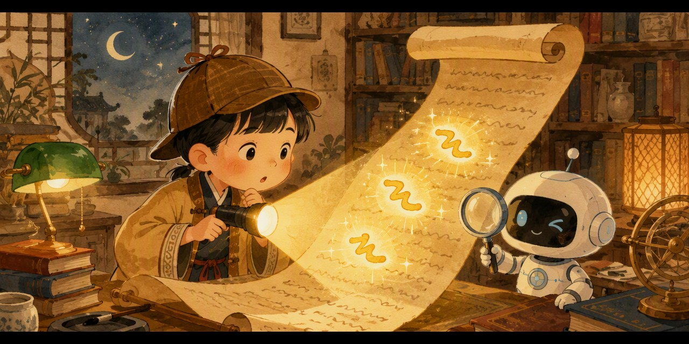

# 焦点小侦探 · 带着问题找重点（Spotlight Quest）

> 问题是手电筒，照到哪里哪里亮——把注意力机制变成孩子的阅读侦探游戏。

## 这是什么？

「和孩子一起学AI」社群 **AI十哲系列 · 第七课** 的配套游戏，把 2017 年谷歌的经典论文 **注意力机制（Attention，《Attention Is All You Need》）** 变成孩子能上手玩的阅读侦探挑战：

- 🔦 **问题是手电筒**：每关先给一个问题——先拿稳它
- 📖 **句子藏重点**：一句话拆成词语卡，答案词和烟雾弹混在一起
- ⚡ **点亮它**：点中藏着答案的词，它会发光；点中烟雾弹？再想想！

## 怎么玩？

1. 双击打开 `index.html`（手机、电脑都行，无需联网）
2. 先看问题卡，再扫句子，点出藏着答案的那个词
3. 三大关卡层层升级：

- 🔦 **短句找主角**：谁？哪里？几个？——照亮对应的词
- ⚡ **长句抗干扰**：时间、天气、无关细节全是烟雾弹
- 👑 **一目十行**：九个字以上的长句，一眼扫过直接点亮重点

4. 集齐三枚徽章 🔦⚡👑，领取「**注意力焦点大师证书**」，截图发群里领奖状！

## 教育目标

- 理解注意力机制的核心直觉：**带着问题读，重点会发光**（Query 照亮 Key，取出 Value 的儿童版表达）
- 迁移到学习：考试先看题再读文章；预习 = 提前提问；划重点 = 找「和问题有关的字」
- 媒介素养：标题党和短视频靠「假问题」劫持注意力——自己的注意力自己作主

## AI十哲系列游戏

| 课次 | 论文 | 游戏 | 仓库 |
| --- | --- | --- | --- |
| 第一课 | 感知机（1957） | 人类还是AI | [human-or-ai](https://github.com/pulj26pulj26/human-or-ai) |
| 第二课 | 图像识别 | 苹果还是不是苹果 | [apple-or-not](https://github.com/pulj26pulj26/apple-or-not) |
| 第三课 | LSTM（1997） | 记忆特工队·小本本大冒险 | [memory-agent](https://github.com/pulj26pulj26/memory-agent) |
| 第四课 | ResNet（2015） | 高速公路工程师·帮AI盖大楼 | [ai-highway](https://github.com/pulj26pulj26/ai-highway) |
| 第五课 | GAN（2014） | 真假画廊·小评委大挑战 | [spot-the-fake](https://github.com/pulj26pulj26/spot-the-fake) |
| 第六课 | AlphaGo（2016） | 胜率指挥官·帮AlphaGo想下一步 | [go-commander](https://github.com/pulj26pulj26/go-commander) |
| 第七课 | 注意力机制（2017） | 焦点小侦探·带着问题找重点 | **spotlight-quest（本仓库）** |

## 本地运行

无需安装任何东西，双击 `index.html` 即可运行。也可以访问在线版：

**https://pulj26pulj26.github.io/spotlight-quest/**

---

Made with ❤️ by 和孩子一起学AI
